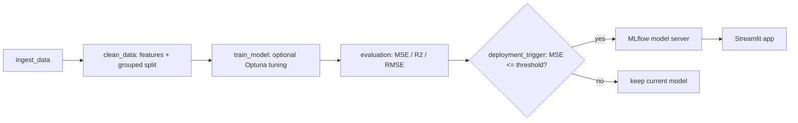

# Customer Satisfaction Prediction: an MLOps pipeline with ZenML and MLflow

Predicts the review score (1-5) of an order from the
[Olist Brazilian E-Commerce dataset](https://www.kaggle.com/datasets/olistbr/brazilian-ecommerce),
using a ZenML pipeline with MLflow experiment tracking and an MLflow-served model
behind a quality gate.

> **Credit.** This project started from ZenML's
> [customer-satisfaction example](https://github.com/zenml-io/zenml-projects) via the
> [mlops-projects-course](https://github.com/ayush714/mlops-projects-course) by ayush714.
> The original template is kept as the starting point; the changes listed below are mine.

## What I changed

| Area | Original | This repo |
|---|---|---|
| Features | 12 numeric columns; date columns dropped | Three feature sets: `baseline`, `pre_order` (known at purchase), `full` (adds actual delivery performance) |
| Train/test split | Random split | **Split by order**: the data has 115,609 rows but only 96,516 orders, so a random split leaks duplicate rows across train and test |
| Hyperparameter tuning | Optimized on the test set | Optuna on a validation split carved from the training data (grouped by order); test set used once |
| Deployment gate | Compared **R² > 0.92** (unreachable, so nothing ever deployed) | Deploys only if **test MSE <= threshold**; keeps the running model otherwise |
| Experiments | One model | LightGBM, XGBoost, Random Forest, Linear Regression across all feature sets, tracked in MLflow |
| App | Asked for 12 inputs | Takes raw order fields and builds features with the same preprocessing code as training |
| Tests | Broken | 15 pytest tests, including regression tests for the leakage bug |
| Environment | Python 3.8-era pins | Working setup on Python 3.10 / Apple Silicon (see below) |

## Results

Metrics are on a held-out test set split by order. R² is low across the board
because review scores are noisy and mostly 5 stars.

**R² by model and feature set (default hyperparameters)**

| Model | baseline | pre_order | full |
|---|---|---|---|
| Linear Regression | 0.015 | 0.020 | 0.128 |
| Random Forest | -0.068 | 0.006 | 0.204 |
| XGBoost | 0.019 | 0.023 | 0.214 |
| LightGBM | 0.033 | 0.047 | 0.233 |

**After tuning (`full` features)**

| Model | MSE | R² |
|---|---|---|
| LightGBM | 1.462 | 0.236 |
| XGBoost | 1.454 | 0.240 |
| Random Forest | 1.460 | 0.237 |

Takeaways:

- Delivery performance is the main signal: R² goes from about 0.03 (baseline) to about 0.24.
- Features known at purchase time barely help (0.05), so predicting satisfaction *before* an
  order is not feasible with this data. The model predicts it once delivery outcomes are known.
- After tuning, the three tree models are within 0.004 R² of each other. The features, not the
  algorithm, are the limit; I would not call any of them the winner.

### The leakage finding

With the original random split, Random Forest scored R² 0.408 on `full` features. After
splitting by `order_id`, the same model scores **0.204**. Multi-item orders appear as several
nearly identical rows with the same review score, so a random split lets a model "predict" test
rows it has effectively seen. Linear Regression barely changed (0.132 -> 0.128), which fits: it
cannot memorize rows. The original repo's baseline R² of 0.083 was inflated the same way
(honest baseline: about 0.03).

### Deployment gate

| `--max-mse` | Test MSE | Outcome |
|---|---|---|
| 1.6 | 1.467 | Model deployed, MLflow server started |
| 1.0 | 1.467 | Deployment skipped; the previously deployed service (same UUID) kept running |

## Pipeline



## Setup

Tested on Python 3.10, macOS (Apple Silicon). This project pins an older ZenML (0.42.2), so
several packages must be held back; the order matters.

```bash
python3.10 -m venv venv
source venv/bin/activate
pip install --upgrade pip
pip install -r requirements.txt

# on macOS, LightGBM and XGBoost need OpenMP
brew install libomp

zenml init
zenml integration install mlflow -y   # if mlflow is not already installed
zenml experiment-tracker register mlflow_tracker --flavor=mlflow
zenml model-deployer register mlflow --flavor=mlflow
zenml stack register mlflow_stack -a default -o default -d mlflow -e mlflow_tracker --set
```

The dataset is expected at `data/olist_customers_dataset.csv` (the merged Olist table).

## Usage

```bash
export SETUPTOOLS_USE_DISTUTILS=stdlib

# train and track an experiment
python run_pipeline.py --feature-set full --model-name lightgbm
python run_pipeline.py --feature-set full --model-name xgboost --fine-tuning

# train, gate on test MSE, deploy, and run a sample inference
python run_deployment.py --max-mse 1.6

# the app (needs a running model server)
streamlit run streamlit_app.py

# tests
python -m pytest -v
```

Options: `--feature-set {baseline,pre_order,full}`,
`--model-name {lightgbm,xgboost,randomforest,linear_regression}`,
`--split-by {order_id,customer_unique_id,none}`, `--fine-tuning`.
View experiments with `mlflow ui --backend-store-uri <path printed by the run>`
(add `--port 5001` on macOS if AirPlay is using port 5000).

## Limitations

- R² around 0.24 means most of the variance in review scores is unexplained. Review text,
  product category and seller information are not used.
- Results come from a single split and seed.
- Serving is local (an MLflow process on port 8000); there is no cloud deployment.
- Predictions are post-delivery only; the app says so.
- ZenML 0.42.2 and MLflow 2.2.2 are old versions, kept so the original pipeline structure works.